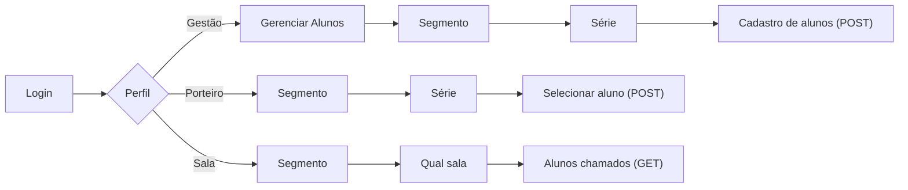
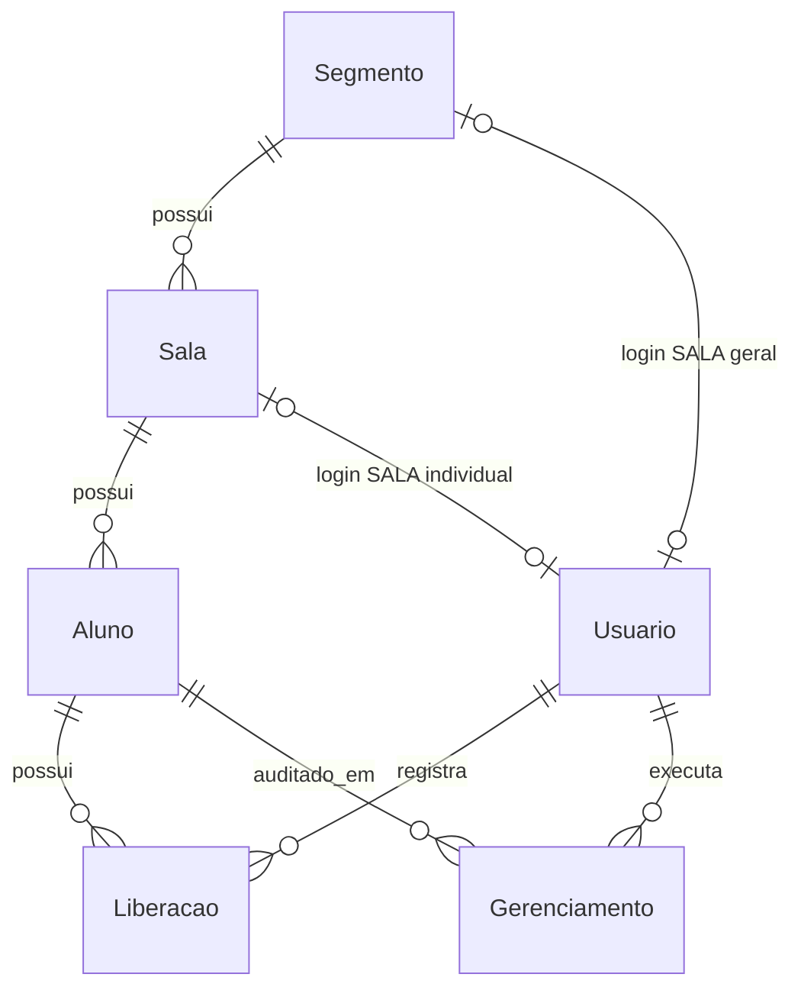

# 🔔 Saída Inteligente

**Chega de fila na portaria.** Sistema de chamada em tempo real que conecta a portaria, a gestão escolar e a sala de aula no momento da saída dos alunos.


> **Publicação bloqueada:** a validação padrão da CLI Prisma e integração/E2E ainda depende da liberação efetiva de `binaries.prisma.sh`. Dados reais também exigem credenciais individuais e operação segura. Consulte [o estado atual](docs/MVP_PROGRESS.md) e o [roteiro de ambiente/produção](docs/PRODUCTION.md).


---

## 📌 O problema

Na saída escolar, o processo de liberar cada aluno costuma depender de chamadas por interfone, deslocamento físico de funcionários ou controle manual em papel — gerando **aglomeração na portaria**, **demora** e **falta de rastreabilidade** de quem saiu e em que horário.

## 🚀 A solução

A **Saída Inteligente** é uma iniciativa de extensão universitária do curso de Sistemas de Informação, que digitaliza esse processo em tempo real, aproveitando a infraestrutura já existente na escola (TVs, projetores e outros aparatos eletrônicos):

- O porteiro registra a chamada em segundos, direto no notebook/tablet.
- O nome do aluno aparece instantaneamente na tela da sala de aula.
- A gestão mantém um cadastro completo e auditável de todos os alunos.

**Resultado:** mais segurança, mais agilidade e zero aglomeração na saída.

---

## 🎯 Objetivo

Desenvolver e implantar um sistema de chamada em tempo real para a saída dos alunos, otimizando a segurança e o fluxo do ambiente escolar, eliminando aglomerações na portaria em horários de pico e estabelecendo um controle rigoroso e auditável para a liberação de cada estudante.

---

## 🧩 Perfis de acesso

| Perfil | O que faz |
|---|---|
| 🛠️ **Gestão** | Cadastra, edita, ativa e inativa alunos da base do sistema |
| 🚪 **Porteiro** | Localiza o aluno informado pelo responsável e registra a chamada |
| 🖥️ **Sala** | Exibe em tempo real, na TV/projetor, a lista de alunos chamados da turma |

## 🔄 Fluxo resumido



> 📄 Documentação completa do fluxo, telas e endpoints disponível em [`/docs`](./docs).

---

## Modelagem de dados

O banco modela a estrutura escolar atual e preserva os registros operacionais e de auditoria. `Segmento` (por exemplo, Fundamental I) possui várias `Sala`s; cada `Sala` pertence a um único segmento e não pode repetir a mesma `serie` dentro dele. Uma Sala possui vários `Aluno`s, cuja `matricula` é única no sistema.



- `Usuario` usa as roles `GESTAO`, `PORTEIRO` e `SALA`. Para `SALA`, o login individual aponta para uma `Sala`; o login geral aponta para um `Segmento`. O escopo geral existe porque, na implementação inicial, alunos de várias Salas do mesmo Segmento podem aguardar liberação no mesmo ambiente. A API e o Socket.io usam esse escopo para consultas e notificações autorizadas. Para `GESTAO` e `PORTEIRO`, ambos os vínculos devem permanecer nulos; para `SALA`, deve existir exatamente um dos dois vínculos.
- `Aluno` tem somente a Sala atual em `salaId`: a progressão anual futura poderá atualizá-lo em lote. A remoção normal é lógica, com `ativo = false`; alunos do último ano também podem ser inativados.
- `Liberacao` é um registro histórico permanente, registrado por um usuário Porteiro. A unicidade de `alunoId` e `dataLiberacao` garante no máximo uma liberação por aluno a cada dia.
- `Gerenciamento` é a auditoria administrativa das ações de cadastro, edição, inativação, reativação e importação, sem duplicar dados de usuário ou aluno.
- As relações estruturais e históricas usam `Restrict` em exclusões para preservar a integridade: não se exclui um Segmento com Salas, uma Sala com Alunos, nem Alunos ou Usuários já referenciados no histórico.

Detalhes adicionais de operação poderão ser documentados futuramente em [`/docs`](./docs).

---

## ✨ Benefícios

**Para a instituição**
- Otimização da logística e aumento da segurança.
- Transparência na liberação dos alunos, gerando percepção de eficiência para os pais.
- Registro digital e consultável do horário exato de liberação de cada estudante — sem custos extras de infraestrutura.

**Para a equipe de desenvolvimento**
- Vivência prática de todo o ciclo de vida do desenvolvimento de software.
- Desenvolvimento de habilidades interpessoais: comunicação, gestão de projetos e negociação com usuários leigos.
- Um caso real de impacto social para o portfólio profissional.

---

## 🛠️ Tecnologias

- Frontend: React + TypeScript + Vite
- Backend: Node.js + Express + TypeScript
- Banco de dados: PostgreSQL 17.11 (Docker Compose no ambiente de desenvolvimento) + Prisma ORM
- Comunicação em tempo real: Socket.io com autenticação e canais por sala/segmento

---

## ⚙️ Como executar o MVP

Requisitos: Node.js 22.12 ou 24+ (validado com 24.22.1), npm, Docker e Docker Compose. O acesso de rede precisa permitir o registro npm, os registros da imagem PostgreSQL e `binaries.prisma.sh` para os comandos padrão do Prisma. Não desabilite TLS nem verificação de checksums para instalar.

```bash
# Na raiz do checkout existente
test -f .env || cp .env.example .env
test -f backend/.env || cp backend/.env.example backend/.env
```

Edite os arquivos ignorados `.env` antes de continuar. Defina uma senha local exclusiva em `POSTGRES_PASSWORD` e use a mesma senha em `backend/.env` → `DATABASE_URL` (codificada na URL se contiver caracteres especiais). Configure `SEED_DEFAULT_PASSWORD` e um `JWT_SECRET` aleatório de pelo menos 32 caracteres. Não use os placeholders dos exemplos nem versione credenciais.

```bash
docker compose up -d --wait

cd backend
npm ci
npm run prisma:generate
npm run prisma:validate
npm run prisma:migrate:deploy
npm run prisma:seed
npm run build
npm run dev
```

Em outro terminal:

```bash
cd frontend
npm ci
npm run build
npm run dev -- --port 5173 --strictPort
```

O backend usa a porta 3000 (`PORT` configurável), conecta ao PostgreSQL antes de escutar e serve `/health`. O Vite encaminha `/api` e `/socket.io` ao backend, evitando manipulação de JWT no frontend. Use o mesmo hostname em `FRONTEND_ORIGIN` e no navegador; o padrão é `http://localhost:5173`. A navegação apresenta `/gestao`, `/portaria` ou `/sala` conforme o perfil, restaurando a sessão pelo cookie HttpOnly.

### Bootstrap temporário

O seed idempotente cria 4 segmentos, 16 salas e 22 usuários, sem alunos de demonstração:

- `gestao` e `portaria`;
- Sala Geral por segmento: `infantil_geral`, `fund1_geral`, `fund2_geral`, `medio_geral`;
- Salas: `infantil_2` a `infantil_5`, `fund1_1ano` a `fund1_5ano`, `fund2_6ano` a `fund2_9ano`, `medio_1ano` a `medio_3ano`.

A senha compartilhada vem exclusivamente de `SEED_DEFAULT_PASSWORD` e é persistida como Argon2id. Reexecutar o seed preserva as senhas existentes; alterar a variável não redefine contas já criadas. O seed é bloqueado em produção. Esta é uma solução temporária de bootstrap para desenvolvimento/MVP: troca individual, recuperação de senha e provisionamento seguro ainda exigem evolução antes de uso operacional com credenciais individuais.

### Testes

A partir de `backend`, com PostgreSQL acessível:

```bash
npm run test:config
npm test
npm run test:e2e
```

`npm run test:config` confere os guardas de produção, cookies e bloqueio do seed. `npm test` cria um banco temporário, aplica as migrations, executa o seed duas vezes e valida HTTP, cookies, autorização, auditoria, importação atômica, constraints e Socket.io. O teste de data cobre a virada do dia em São Paulo. Os testes usam exclusivamente a CLI padrão, sem runner externo em `/tmp`. O usuário de banco para testes precisa de permissão `CREATEDB`; os bancos temporários são removidos ao final. Não execute testes contra uma instância de produção.

Para os testes E2E, instale primeiro o Chromium do Playwright a partir de `frontend` (`npx playwright install --with-deps chromium`), ou defina `PLAYWRIGHT_CHROMIUM_EXECUTABLE_PATH` para um Chromium já instalado. O runner de `backend` gera credenciais aleatórias, prepara outro banco temporário e sobe API/Vite nas portas 3100/5180. Valida no navegador Gestão, Portaria, Sala, Sala Geral, isolamento, chamada duplicada, recuperação após ficar offline, restauração de sessão e logout. Não reutiliza serviços nem banco de desenvolvimento. Traces de falhas podem conter dados/cookies de teste: ficam ignorados em `frontend/test-results/`.

### Migrations e persistência

O schema está em `backend/prisma/schema.prisma`; mantenha migrations compartilhadas imutáveis. Para uma mudança futura de modelagem, use `npm run prisma:migrate:dev -- --name nome_da_migration` em desenvolvimento. `prisma db push` não faz parte do fluxo normal.

A porta do Compose é local (`127.0.0.1`), e a conta configurada por POSTGRES_USER é administrativa de desenvolvimento; não usá-la como runtime de produção. `docker compose restart postgres` preserva os dados no volume. `docker compose down` encerra o serviço preservando o volume. **`docker compose down -v` apaga os dados locais**; não use para reiniciar o ambiente.

### Contratos e limites

Veja [API REST, segurança e eventos Socket.io](docs/API.md), [backlog consultado](docs/BACKLOG_REFERENCE.md), [validações e progresso](docs/MVP_PROGRESS.md) e [preparação de release](docs/RELEASE_MVP.md). O planejamento inicial permanece em [docs/planejamento-mvp.md](docs/planejamento-mvp.md); em divergências, mantêm-se as decisões consolidadas em develop: Segmento, Sala Geral, enums de auditoria, cookie HttpOnly e Argon2id.

Em produção, use HTTPS e frontend/API no mesmo site, com reverse proxy de `/api` e `/socket.io`. FRONTEND_ORIGIN HTTPS explícita agora é exigida na inicialização. O [roteiro de produção](docs/PRODUCTION.md) cobre ambiente, exemplos Nginx/systemd, permissões, banco, credenciais, backup/restauração, monitoramento e `npm run test:production` para smoke local do proxy. Este repositório fornece Compose para o PostgreSQL de desenvolvimento, não provisionamento de produção. O histórico é permanente, mas nomes e sala exibidos em registros antigos acompanham o cadastro atual conforme a modelagem existente. Não há relatórios avançados, edição de chamadas, revogação central de tokens, refresh token nem gestão de credenciais individuais. Consulte os resultados realmente executados em MVP_PROGRESS.md antes de publicar uma release.

---

## 👥 Equipe

| Nome | Função |
|---|---|
| `_______` | `_______` |
| `_______` | `_______` |
| `_______` | `_______` |

---

## 📄 Licença

Este projeto está sob a licença MIT — veja o arquivo [LICENSE](./LICENSE) para mais detalhes.

---

<p align="center">Projeto desenvolvido como parte das Atividades Práticas Interdisciplinares de Extensão II — Sistemas de Informação</p>
